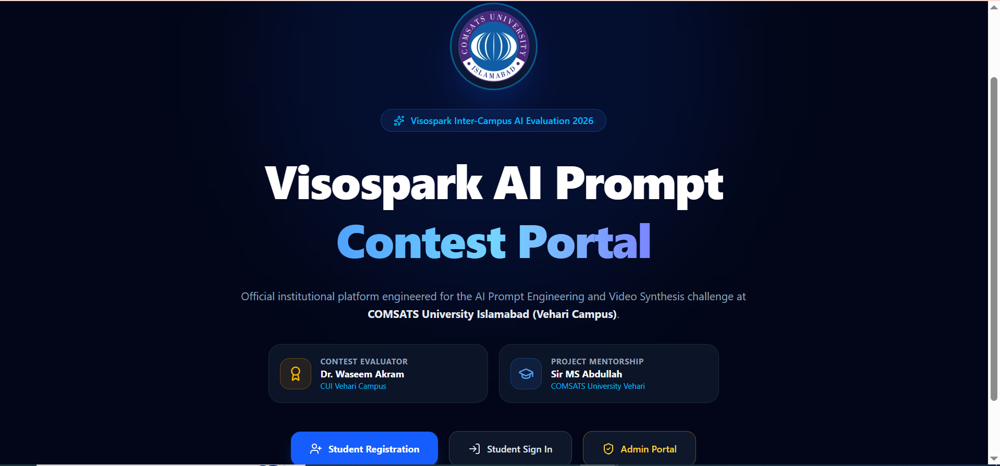
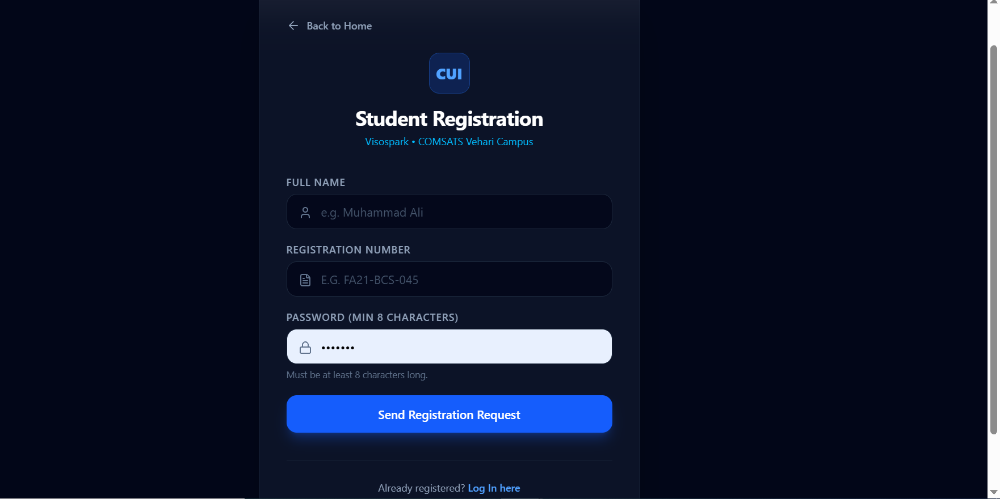
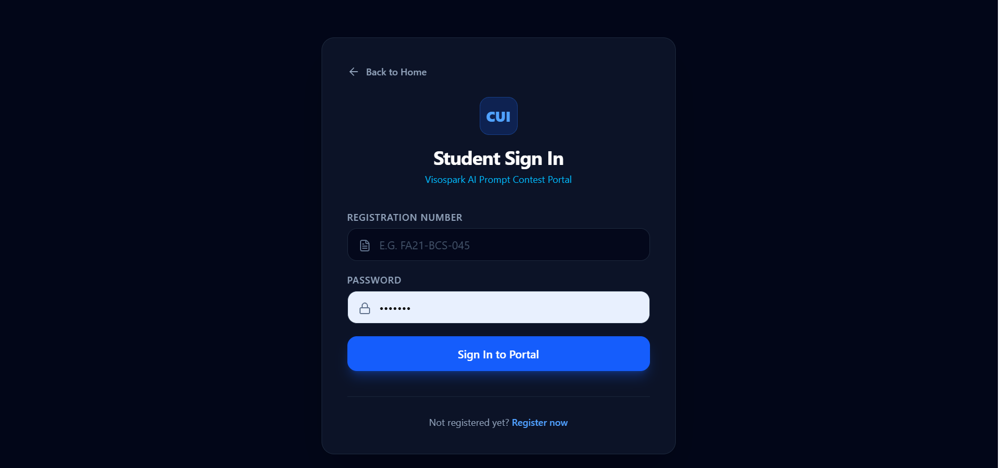
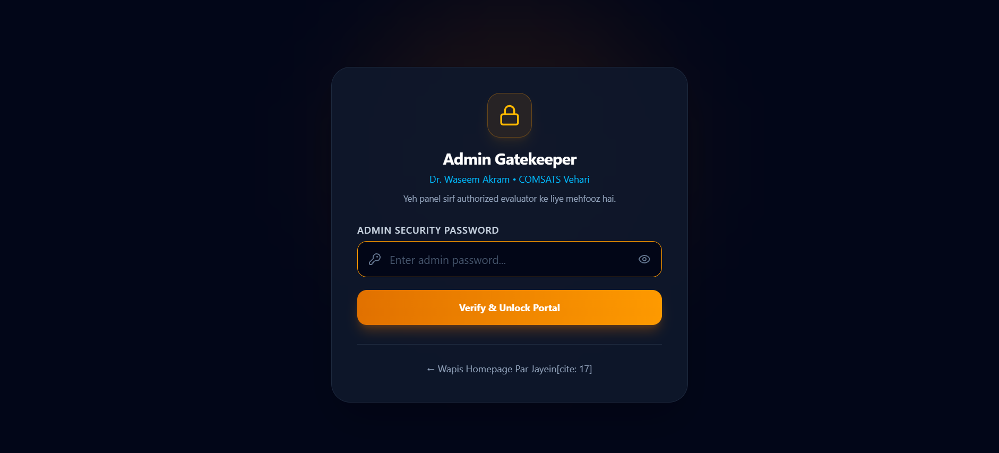
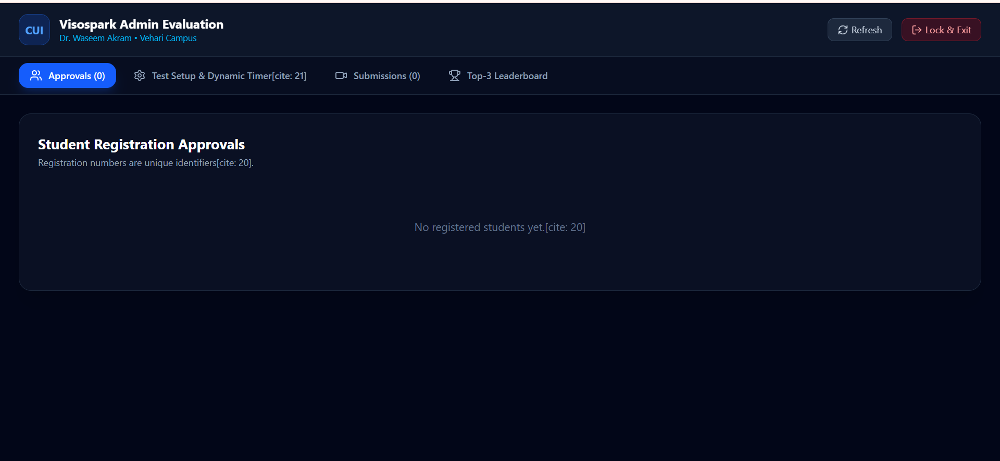

# ⚡ Visospark AI Prompt Engineering Contest Portal
### COMSATS University Islamabad • Vehari Campus

An institutional, real-time web portal engineered for the **Visospark AI Video Prompt Engineering Competition** hosted at **COMSATS University Islamabad (Vehari Campus)**.

The system facilitates secured student registration with unique identifier verification, dynamic server-synchronized test windows, live submission tracking, instructor resource dispatch, and an automated grading and leaderboard pipeline.

---

## 🏛️ Academic & Mentorship Hierarchy

- **Lead Developer:** **Rana Muhammad Ali** (Department of Software Engineering, CUI Vehari)
- **Project Mentorship & Supervision:** **Sir MS Abdullah** (COMSATS University Islamabad, Vehari Campus)
- **Lead Evaluator & Administrator:** **Dr. Waseem Akram** (COMSATS University Islamabad, Vehari Campus)

---

## 📸 System Architecture & Visual Walkthrough

### 1. Institutional Landing Portal (`/`)

> **Description:** The entry landing interface displaying official COMSATS University Islamabad (Vehari Campus) circular emblem, academic attributions for **Sir MS Abdullah** and **Dr. Waseem Akram**, and responsive navigation gateways for applicant registration, approved student sign-in, and administrative access.

---

### 2. Candidate Registration (`/register`)

> **Description:** A secured student intake interface requiring Full Name, unique Institutional Registration Number (e.g., `FA21-BCS-045`), and encrypted authentication credentials. Strictly enforces unique student records in PostgreSQL to eliminate duplicate examination entries.

---

### 3. Student Authentication Gate (`/login`)

> **Description:** Verified session-entry point for participants. Authenticates against the Supabase identity ledger and verifies whether Dr. Waseem Akram has granted approval before routing candidates directly into the secure contest room (`/contest`).

---

### 4. Admin Gatekeeper Security (`/admin`)

> **Description:** Protected security layer preventing unauthorized intrusion into evaluator controls. Restricts operational parameters, registration approvals, and grading rights behind Dr. Waseem Akram's authorized key verification (`Dr_404.`).

---

### 5. Evaluator Dashboard & Dynamic Timer Hub (`/admin`)

> **Description:** Administrative evaluation hub featuring real-time tab switching: candidate approvals, dynamic exam duration adjustment (15 to 180 minutes), server UTC timestamp trigger (`Start Contest Now`), Google Drive reference material synchronization, video grading out of 100 with feedback, and an automated top-3 podium leaderboard.

---

## 🛠️ Technology Stack

| Layer | Technology |
|---|---|
| **Framework** | Next.js (App Router, Turbopack) |
| **Language** | TypeScript |
| **Styling** | Tailwind CSS with PostCSS |
| **Backend & Database** | Supabase (PostgreSQL with Row Level Security) |
| **Icons** | Lucide React |
| **Deployment Target** | Vercel Serverless Edge Platform |

---

## 📂 System Workflow & Routes

```text
Visitor ───► [/] Landing Portal (Official COMSATS Branding)
               │
               ├──► [/register] Student Registration (Creates pending verification record)
               │
               ├──► [/login] Approved Candidate Portal
               │          └──► [/contest] Live Examination Chamber (Dynamic Timer & Drive Link)
               │
               └──► [/admin] Evaluator Gatekeeper (Password: Dr_404.)
                          ├── Student Approvals (Unique Registration IDs)
                          ├── Test Setup & Server Timestamp Timer
                          ├── Video Submission Review & Marking (0 - 100)
                          └── Top-3 Automated Podium Leaderboard